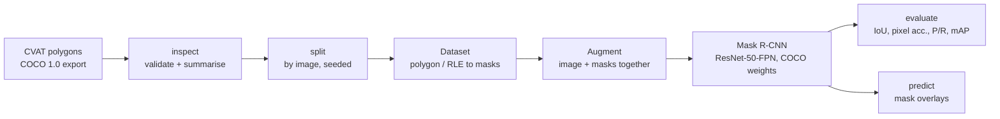

# Paddy Pest Segmentation

**From hand-drawn CVAT polygons to an evaluated Mask R-CNN model for insects in paddy field images.**


Insects are a major cause of yield loss in rice. Finding them early, and telling them apart from leaves, water and soil, is a pixel-level task: a bounding box around a thin, irregular insect on a leaf is mostly leaf. This project trains an instance segmentation model that outlines each insect with a mask.

The repository is the production-grade rebuild of my M.Sc. Data Analytics coursework (BSBI Berlin, module *Computer Vision and Artificial Intelligence*, January 2025). I annotated the dataset myself in CVAT; the code has been rewritten as a typed, tested Python package. See [What changed from the coursework](#what-changed-from-the-coursework).

---

## What it does



| Step | Module | Detail |
|---|---|---|
| Load and validate | `paddyseg.coco` | Checks ids, references, image sizes and segmentations before anything runs. Reads polygons, uncompressed RLE (CVAT brush tool) and compressed RLE. |
| Split | `paddyseg.coco.split_coco` | Train/val/test **by image**, so no picture appears in two sets. Seeded and repeatable. |
| Augment | `paddyseg.transforms` | Horizontal and vertical flips, random scale and rotation, brightness and contrast. Geometric changes hit image and masks with the same parameters; colour changes hit the image only. |
| Dataset | `paddyseg.dataset` | Rasterises masks, maps COCO category ids to contiguous labels, recomputes tight boxes from masks after augmentation and drops instances pushed out of frame. |
| Model | `paddyseg.model` | torchvision Mask R-CNN, ResNet-50-FPN, transfer learning from COCO, new box and mask predictors. |
| Train | `paddyseg.engine` | SGD with step decay, gradient clipping, NaN guard, best-checkpoint on validation loss, `history.csv`. |
| Evaluate | `paddyseg.metrics` | Mask IoU, foreground IoU, pixel accuracy, precision/recall/F1 with greedy matching, and COCO mask and box mAP (pycocotools). |

## The dataset

`data/annotations/paddy_pest_coco.json` holds my annotations: **112 images, 127 insect instances**, one class (`insect`), exported from CVAT as COCO 1.0. The images were supplied by the university for the module and are **not redistributed**; put your copies in `data/images/` with the same file names.

Output of `paddyseg inspect` on this file:

| Measure | Value |
|---|---|
| Images / instances | 112 / 127 |
| Images with no insect (negatives) | 5 |
| Polygon / RLE annotations | 123 / 4 |
| Median instance area | 8,486 px |
| COCO size buckets (small / medium / large) | 21 / 45 / 61 |
| Default split (train / val / test images) | 78 / 17 / 17 |

One in six insects is *small* by COCO's definition (under 32 x 32 pixels), which is why the evaluation reports AP by object size.

## Quick start

```bash
git clone https://github.com/pankaj-chaubay/paddy-pest-segmentation.git
cd paddy-pest-segmentation
python -m venv .venv && source .venv/bin/activate   # Windows: .venv\Scripts\activate
pip install -e ".[dev]"

# 1. Look at the annotations
paddyseg inspect data/annotations/paddy_pest_coco.json

# 2. Split by image into train / val / test
paddyseg split data/annotations/paddy_pest_coco.json --out-dir data/splits

# 3. Check that masks follow every augmentation (writes a before/after PNG)
paddyseg augment data/splits/train.json --images data/images --out outputs/augmentation_preview.png

# 4. Fine-tune (a GPU is strongly recommended; Google Colab's free T4 is enough)
paddyseg train --train data/splits/train.json --val data/splits/val.json \
               --images data/images --out outputs/run --epochs 20 --batch-size 2

# 5. Evaluate on the untouched test split
paddyseg evaluate data/splits/test.json --images data/images \
                  --checkpoint outputs/run/best.pt --out outputs/test_report.json

# 6. Draw predictions
paddyseg predict data/images/00000000.jpg --checkpoint outputs/run/best.pt
```

Every command has `--help`. Expected errors (missing file, broken annotation, image size mismatch) end with a clear message and exit code 2 instead of a stack trace.

### Using it from Python

```python
from torch.utils.data import DataLoader
from paddyseg.dataset import CocoInstanceDataset, collate_fn
from paddyseg.transforms import build_transforms
from paddyseg.model import build_model

train = CocoInstanceDataset("data/splits/train.json", "data/images", transforms=build_transforms(train=True))
loader = DataLoader(train, batch_size=2, shuffle=True, collate_fn=collate_fn)
model = build_model(train.num_classes)          # 2 = background + insect
```

## Evaluation metrics

| Metric | What it answers |
|---|---|
| **Mask IoU** (matched) | For insects the model found, how well do the outlines overlap the true outlines? |
| **Foreground IoU** | Over all images, how well does "pixels the model calls insect" overlap "pixels that are insect"? |
| **Pixel accuracy** | Share of pixels classified right. Shown for completeness; it looks good even for a weak model because most pixels are background. |
| **Precision / recall / F1** | At IoU 0.5 and a score threshold of 0.5: how many detections are real, and how many insects were found? |
| **COCO mAP** (mask and box) | Average precision over IoU 0.50 to 0.95, plus AP50, AP75 and AP by object size, computed with pycocotools so it is comparable to published work. |

`evaluate` writes all of them to one JSON report.

## Project layout

```
src/paddyseg/
  coco.py         load, validate, summarise and split COCO files
  transforms.py   joint image + mask augmentation (torchvision.transforms.v2)
  dataset.py      COCO -> Mask R-CNN targets
  model.py        Mask R-CNN construction
  engine.py       training, validation loss, inference, checkpoints
  metrics.py      IoU, pixel accuracy, P/R/F1, COCO mAP
  visualize.py    mask and box overlays
  cli.py          the paddyseg command
tests/            40 tests on a synthetic dataset; no images or GPU needed
data/annotations  my CVAT export
docs/             review of the original coursework code
```

## Quality checks

```bash
pytest                      # 40 tests, about 30 s on a laptop CPU
ruff check src tests        # lint
ruff format --check src tests
mypy                        # strict type checking
```

The tests build a small synthetic dataset (coloured backgrounds with elliptical "insects", one RLE annotation, one empty image) and cover validation rules, mask rasterisation, the split, augmentation alignment, metric edge cases, a perfect-prediction mAP of 1.0, one training epoch, checkpoint reload, evaluation and the CLI. GitHub Actions runs the same checks on every push.

## What changed from the coursework

The original was a Google Colab notebook built on Detectron2. A review of it is in [docs/coursework_review.md](docs/coursework_review.md). The main fixes:

| Coursework notebook | This repository |
|---|---|
| Detectron2 config `faster_rcnn_R_50_FPN`, which predicts boxes only, so no masks were trained | Mask R-CNN with a mask head, as the brief required |
| Train and validation registered on the **same** JSON file, so validation scores measured memory, not generalisation | Seeded split by image into train, val and test |
| Augmentation described in the report but not applied in code | Joint image and mask augmentation, with a test that proves alignment |
| IoU, mAP and pixel accuracy explained but not computed | All of them computed, plus precision, recall and F1 |
| Hard-coded Colab and Drive paths, `!pip` cells | Installable package with a CLI and no environment assumptions |
| No error handling or tests | Validation with clear errors, 40 tests, strict typing, CI |

## Limitations

- **No trained results are published here.** The coursework model was trained in a shared Colab session and the weights were not kept. Train with the commands above on a GPU to reproduce; the README will be updated with test-set numbers.
- 112 images is a small dataset. Expect high variance between splits; k-fold cross-validation is the next step.
- One class only. Telling pest species apart needs more labelled data per species.

## Author

**Pankaj Chaubay**, M.Sc. Data Analytics (BSBI Berlin), Lean Six Sigma Black Belt. Munich, Germany.
[LinkedIn](https://www.linkedin.com/in/pankaj-chaubay) · [GitHub](https://github.com/pankaj-chaubay)

## License

Code: MIT. Annotations in `data/annotations/`: CC BY 4.0.
